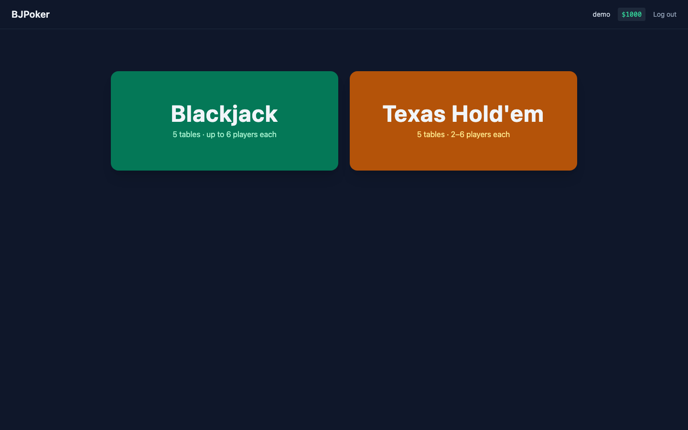
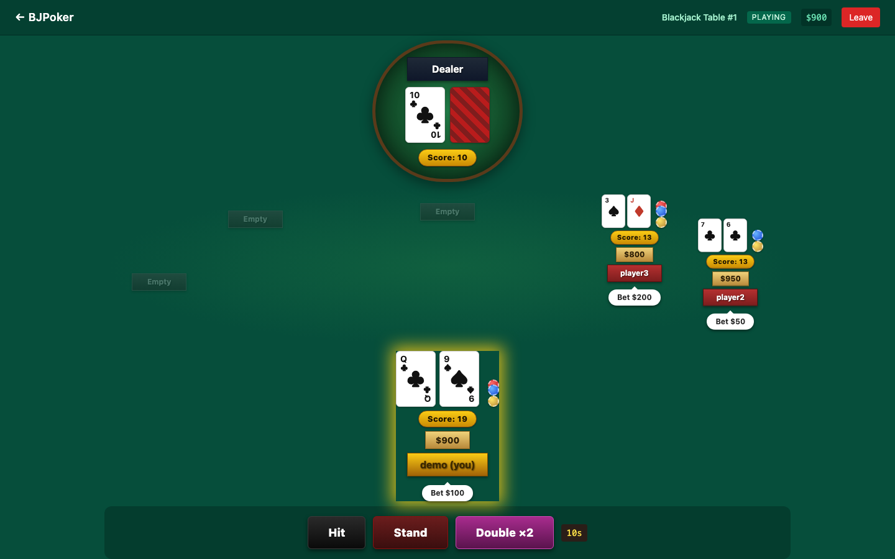
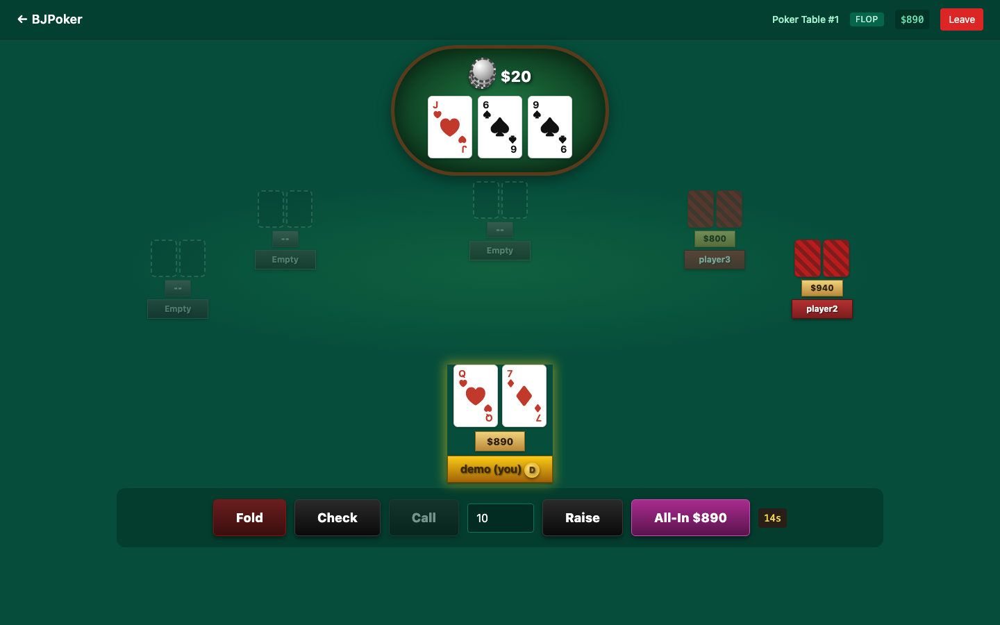

# BJPoker

A real-time multiplayer Blackjack and Texas Hold'em game that runs in the browser.

## About

BJPoker is a university project for an Object-Oriented Programming module.
Players create an account, pick a game, and join a table with other players.
All game logic runs on the server, built as a set of JavaScript classes.
The browser only shows the state the server sends and sends player actions back.

The game uses play money only. Every new account gets 1000 chips.
There are no real-money payments, deposits or withdrawals.

## Features

- Register and log in. Passwords are hashed with bcrypt. Sessions use a JWT in an httpOnly cookie.
- Lobby with 5 Blackjack tables and 5 Texas Hold'em tables, up to 6 players each.
- Live table updates for all players through Socket.IO rooms.
- Blackjack: bet, hit, stand, double. The dealer stands on all 17s. Blackjack pays 3:2.
- Texas Hold'em: blinds (5/10), fold, check, call, raise, all-in, hand ranking at showdown.
  There are no side pots: once a player is all-in, the rest of the board is dealt automatically.
- Turn timers. If a player does not act in time, the server acts for them.
- If a player disconnects or refreshes, their seat is kept for 30 seconds.
- Each player only receives their own hole cards.
- Chip balances and a per-round game history are saved in MongoDB.
- 72 unit tests for the game classes, using the built-in Node.js test runner.

## Tech stack

- Server: Node.js, Express, Socket.IO, Mongoose
- Database: MongoDB
- Auth: JSON Web Tokens, bcryptjs
- Client: plain HTML and JavaScript (ES modules), Tailwind CSS
- Tests: `node --test`

## Screenshots

Lobby:



Blackjack table:



Texas Hold'em table:



## Project structure

```
client/          Static pages, client scripts and CSS
server/
  game/          Game classes (Card, Deck, Hand, Player, Table, Game and their subclasses)
  lobby/         Table manager
  models/        Mongoose models (User, GameHistory)
  routes/        REST routes for auth
  sockets/       Socket.IO handlers for lobby, Blackjack and poker
  test/          Unit tests
```

The game classes use inheritance. For example, `BlackjackHand` and `PokerHand` extend `Hand`,
and `BlackjackGame` and `PokerGame` extend `Game`.

## Run locally

You need Node.js 20 or newer and Docker (or any local MongoDB).

1. Clone the repo and install dependencies:

   ```bash
   git clone https://github.com/liteee69/BJPoker.git
   cd BJPoker
   npm install
   ```

2. Start MongoDB in Docker:

   ```bash
   docker run -d --rm -p 27017:27017 --name bjpoker-mongo mongo:7
   ```

3. Create a `.env` file from the example:

   ```bash
   cp .env.example .env
   ```

   Then set `JWT_SECRET` to a long random string. The server will not start without it.
   One way to make one:

   ```bash
   openssl rand -hex 32
   ```

   | Variable     | Required | Example                                  |
   |--------------|----------|------------------------------------------|
   | `MONGO_URI`  | yes      | `mongodb://localhost:27017/cardgame`     |
   | `JWT_SECRET` | yes      | a long random string                     |
   | `PORT`       | no       | `3000` (default)                         |
   | `NODE_ENV`   | no       | `development` or `production`            |

4. Start the server:

   ```bash
   npm start        # or: npm run dev (restarts on file changes)
   ```

5. Open http://localhost:3000 and register an account.

   Poker needs at least 2 players at a table. To try it alone, register a second account
   in a private browser window and join the same table.

To stop MongoDB:

```bash
docker stop bjpoker-mongo
```

## Tests

```bash
npm test
```

## CSS

The compiled Tailwind file (`client/css/tailwind.css`) is committed, so you do not need to build it.
If you change classes in the HTML or JS, rebuild it:

```bash
npm run build:css
```

## License

MIT. See [LICENSE](LICENSE).
